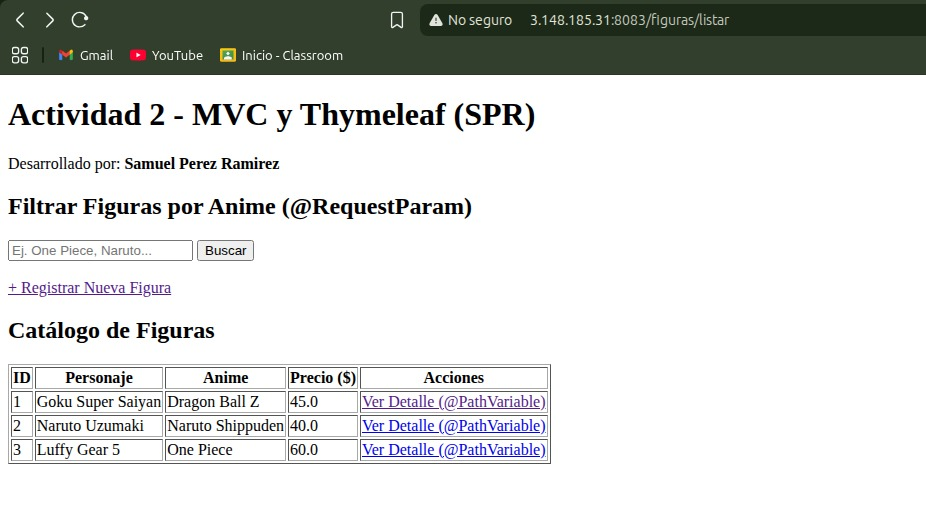
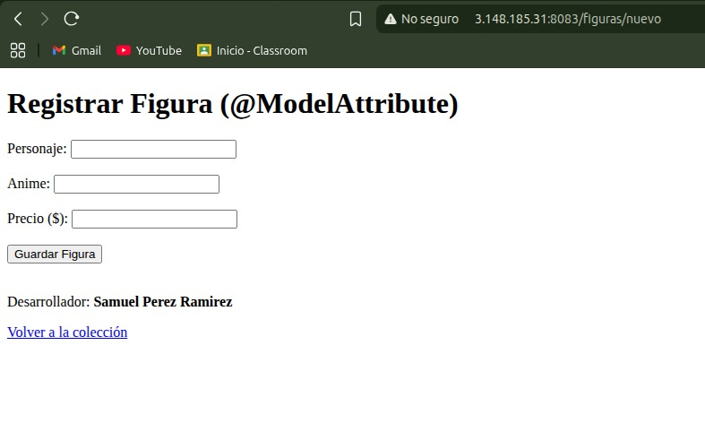
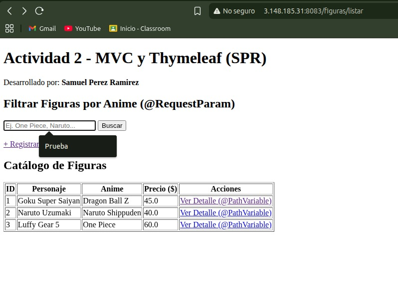
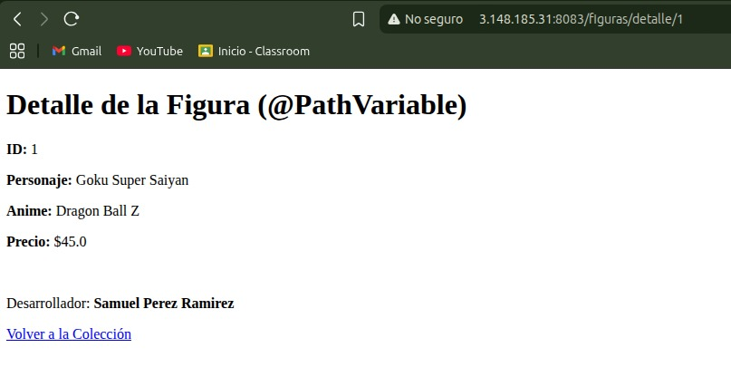
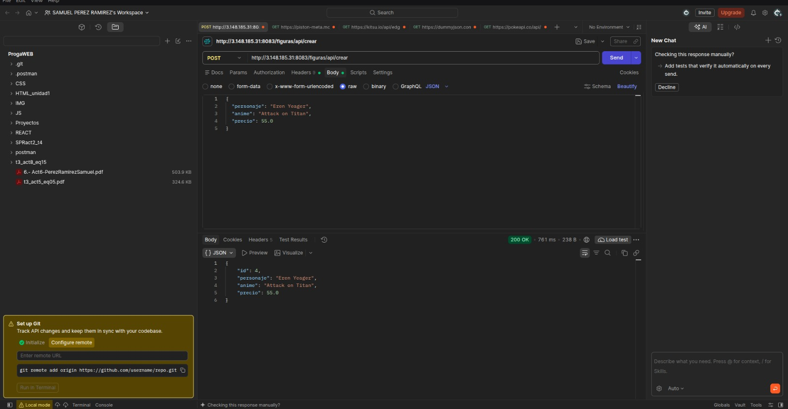

# Actividad 2: MVC, Thymeleaf, DTOs y Peticiones REST en Spring Boot (`SPRact2_t4`)

---

## Descripción del Proyecto

Este proyecto implementa el patrón de arquitectura **MVC (Modelo-Vista-Controlador)** utilizando **Spring Boot 3.2.5** y el motor de plantillas **Thymeleaf** para el renderizado de vistas dinámicas del lado del servidor. Se gestiona una colección de figuras de anime a través de clases DTO y controladores annotated con `@Controller`.

Además, incluye integración de propiedades personalizadas mediante `@Value`, consumo de parámetros por `@RequestParam` y `@PathVariable`, recepción de datos de formularios con `@ModelAttribute` y un endpoint REST adicional para recibir peticiones `POST` en formato JSON con `@RequestBody`.

---

## Características

* **Vista de Catálogo General:** `/figuras/listar`  
  Muestra el listado de figuras de anime mediante un recorrido dinámico con `th:each`.
* **Filtro por Criterio (@RequestParam):** `/figuras/listar?anime=One Piece`  
  Filtra la lista de figuras según la franquicia ingresada.
* **Detalle de Elemento (@PathVariable):** `/figuras/detalle/{id}`  
  Carga la vista individual con los detalles de una figura específica por su ID.
* **Formulario de Registro (@ModelAttribute):** `/figuras/nuevo` y `/figuras/guardar`  
  Formulario HTML para registrar nuevas figuras en la colección.
* **Endpoint REST API (@RequestBody + @ResponseBody):** `POST /figuras/api/crear`  
  Endpoint dedicado para pruebas de integración recibiendo un objeto JSON en Postman/Bruno.

---

## Evidencias 

### 1. Vista con Listado General (`th:each`)

### 2. Formulario de Registro (`@ModelAttribute`)

### 3. Filtro de Búsqueda (`@RequestParam`)

### 4. Vista Detallada por ID (`@PathVariable`)

### 5. Petición POST JSON en Postman (`@RequestBody`)

---

##  Links

* **Actividad 2 (Puerto 8083):** `http://3.148.185.31:8083/figuras/listar`
---

